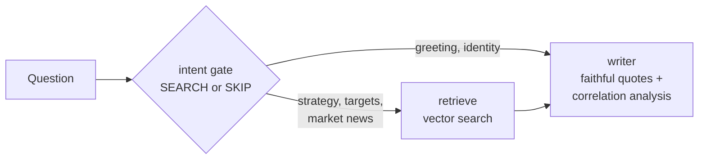

# Strategic Planning RAG

A chat assistant for the strategic planning team: it answers questions about each business unit's ambitions, targets and guidelines, and correlates market news with the company's strategy, quoting the source documents faithfully.

**Stack:** Python · LangGraph · LangChain · Azure OpenAI · Azure AI Search · Azure Document Intelligence · Streamlit
**Role:** Lead developer: design and implementation

> Built at a large Brazilian insurer. The company is replaced by the fictional **Acme Seguros**, and every name, document and data point here is fictional. Code, prompts and UI are in Portuguese, written for Brazilian business teams.

## Problem

Strategy documents for each business unit (auto, life and pensions, health, dental, capitalization) were long and scattered. People needed exact targets and guidelines, not a paraphrase, and wanted to know how market news related to the plan.

## What I built



- **Intent gate:** a small classifier decides whether a message needs the documents at all, so greetings don't trigger a search.
- **Fidelity rule:** the writer quotes the original text, keeps lists and targets as written, and never summarises away a number.
- **Structured answer:** a correlation analysis between the question (or the news item) and the internal strategy.
- **Ingestion script** for PDF and Word files through Document Intelligence.

## Run it

```bash
python -m venv .venv && .venv\Scripts\activate   # macOS/Linux: source .venv/bin/activate
pip install -r requirements.txt
cp .env.example .env                               # Azure OpenAI + AI Search
python ingest.py                                   # index your strategy documents
streamlit run agent.py
```

---
Part of my [AI engineering portfolio](https://github.com/lucasboliveirasipp).
